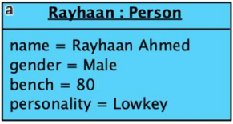
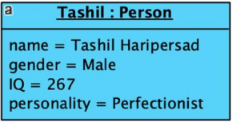
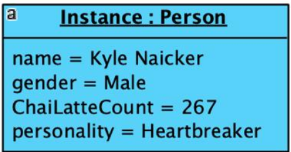
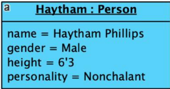
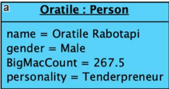

## Team Contributions

**Team: Power Rangers**

| Profile | Student Name | Student Number | Key Contributions |
|:---:|---|---|---|
|  | **Rayhaan Ahmed** | `u25047762` | UML Activity Diagram 3 (Detailed Scenario Execution) |
|  | **Tashil Haripersad** | `u25466004` | Documentation Compilation & Structuring |
|  | **Kyle Naicker** | `u25040040` | UML Activity Diagram 1 (Engine Lifecycle) & WorkItem State Diagram |
|  | **Haytham Phillips** | `u25030907` | UML Activity Diagram 2 (Approval/Assignment) & Sequence Diagram 2 |
|  | **Oratile Lesedi Rabotapi** | `u25243269` | UML Sequence Diagram 1 (Instantiation & Execution) |