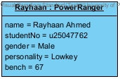
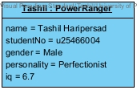
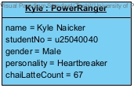
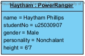
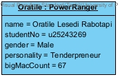

# TIVIDY - Generic Workflow Management System

TIVIDY is a C++11 workflow management system built using standard Gang of Four (GoF) design patterns. It coordinates task lifecycles, assignment strategies, escalation/approval handler chains, and multi-level undo operations across diverse domain models.

The engine natively demonstrates two distinct industry pipelines:
1. **Incident Response (Power Outage)**
2. **Job Application (Tech Company)**

---

## 1. System Requirements & Dependencies

The dependencies required to build and verify TIVIDY mirror the packages installed in the project `Dockerfile`:

### Requirements:
* **Operating System**: Linux (Ubuntu 20.04 recommended), macOS or Windows via WSL2 / Docker.
* **C++ Compiler**: `g++` with support for `-std=c++11`, `-Wall` and `-Werror`.
* **Build System**: GNU Make 4.0+ (`make`), CMake 3.10+.
* **Testing Framework**: GoogleTest `release-1.12.1` built with C++11 constraints. (The latest version of GoogleTest requires C++14 or later so we use an older verson of GoogleTest)
* **Memory Checking**: `valgrind`
* **Documentation Engine (Optional)**: `doxygen`
* **System Utilities**: `git`, `ca-certificates` and `pthread` 

---

## 2. Docker Instructions (Highly Recommended)


### Build the Docker Image
```bash
docker build -t tividy-ci:latest .

# Run Unit Tests
docker run --rm tividy-ci:latest make test

# Run Valgrind
docker run --rm tividy-ci:latest make valgrind

# Stop Container
docker stop <tividy-ci:latest>

```

## Team Contributions

**Team: Power Rangers**

| Profile | Key Contributions |
|:---:|---|
|  | Activity Diagram 3, GUI, Implementation: Command, Memento |
|  |Report, Demo slides, Class Diagram, Implementation: Strategy, Chain of Responsibility, Façade, main |
|  |Activity Diagram 1, State Diagram, Additional diagrams: 2 Object Diagrams and 1 Communication Diagram, Docker, Implementation: State, Iterator, Visitor|
|  |Activity Diagram 2, Sequence Diagram 2, CI/CD pipeline, Integration tests and end-to-end tests, Implementation: Builder, Mediator, exception classes|
|  |Sequence Diagram 1, GUI, Implementation: Composite, Decorator, Prototype |

All members contributed the header and source files of their own patterns, including the Doxygen comments and unit tests.
### Built With


